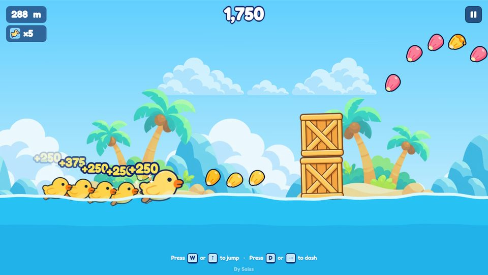
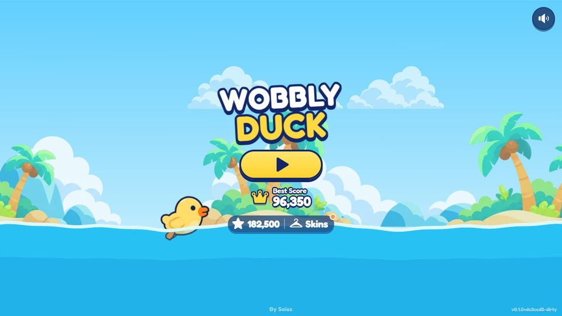
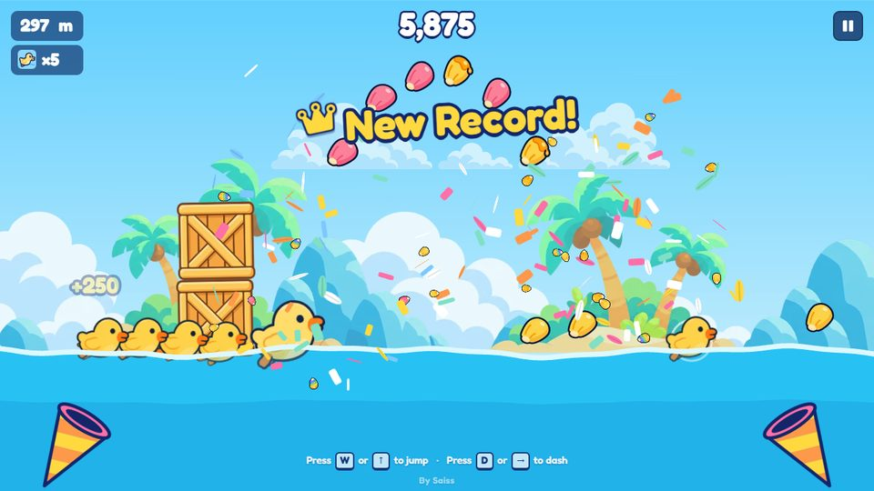
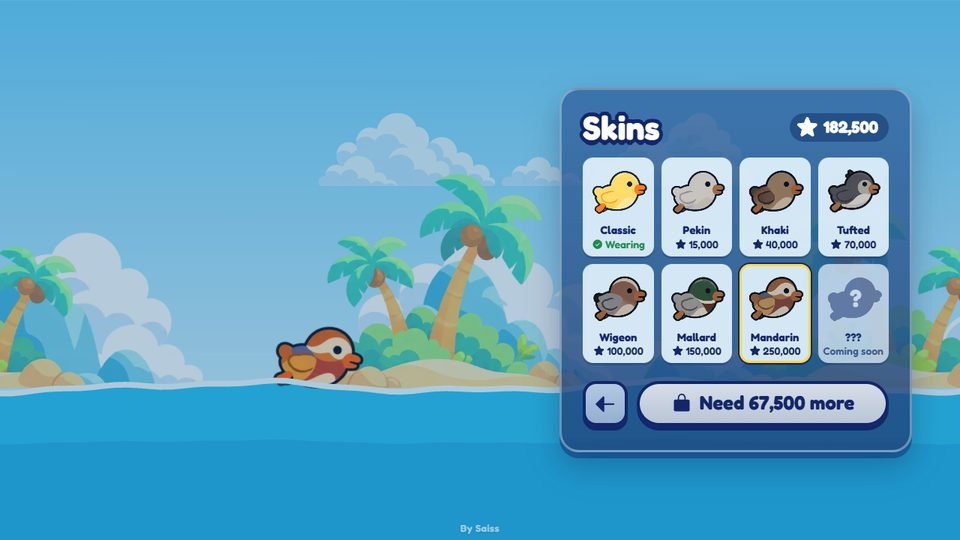

# Wobbly Duck

**Hop, dash and splash down an endless river as a wobbly little duck.** A cheerful 2D endless
runner for desktop and mobile browsers, published on [Poki](https://poki.com). Built with
Phaser 3, TypeScript and Vite.

<p align="center">
  
</p>

<p align="center">
  
  
  
</p>

## The game

Guide a chubby, squishy duck down a never-ending river. Jump over logs and rocks, double jump
over crate stacks, and dash to smash crates. Collect corn kernels for points, then spend them on
new ducks.

- **Duckling Parade.** Lost ducklings join a line behind you and copy your jumps a beat later.
  Each one multiplies your score (×2 up to ×7), but an obstacle that hits one knocks it out.
- **Two buttons, lots of moves.** Jump, double jump in the air, dash. Lily pads bounce you high.
- **Eight corn kernels**, from yellow (50) to crown (1,000), placed in trails, arcs and sky lines.
- **It gets harder**: speed ramps up and new patterns unlock at 200 m and 800 m.
- **A changing world**: from 450 m every run drifts from tropical islands into a mountain lake.
- **Goals**: a BEST flag floats in the river at your best distance. Passing your best score
  triggers a "New Record!" party.
- **Skins shop**: seven ducks bought with your total score (Classic, Pekin, Khaki, Tufted,
  Wigeon, Mallard, Mandarin), each with its own unlock celebration.
- **Watch-an-ad revive**: once per run after a crash, through Poki's rewarded ads.

## Controls

The duck swims by itself. On a player's first run the river pauses at the first log and the first
crate, and a callout shows exactly what to press; on later runs the DASH button (or the D key)
glows whenever a crate is coming and the dash is ready.

| Action | Desktop | Touch |
| --- | --- | --- |
| Jump (press again in the air to double jump) | W, ↑ or Space | **JUMP** button (bottom-left), or tap the left half |
| Dash (smashes crates) | D or → | **DASH** button (bottom-right), or tap the right half |
| Start | Enter, a jump key or D | Play button, or any tap on the menu |
| Play again | Enter | Play Again button |
| Pause / resume | Esc or P | Pause button |

## Getting started

Needs **Node.js 20+**. The asset tools also need **Python 3** with `pillow` and `numpy`.

```bash
npm install
npm run dev          # http://localhost:5173 (also printed as a LAN URL for phone testing)
```

| Script | What it does |
| --- | --- |
| `npm run dev` | Dev server with hot reload |
| `npm run typecheck` | TypeScript check (must pass before committing) |
| `npm run build` | Production build into `dist/` |
| `npm run preview` | Serve the last production build |
| `npm run build:poki` | Poki build into `dist-poki/` and a zip ready to upload (see below) |

**Debug mode:** add `?debug` to the URL to draw hit boxes, log Game Events to the console and
expose the scene as `window.__scene`. Debug mode is stripped from the Poki build.

## Poki build and versions

`npm run build:poki` builds with the real [Poki HTML5 SDK](https://developers.poki.com/guide/sdk-html5)
and zips the result as `wobbly-duck-poki-v<version>-<commit>.zip`, with `index.html` at the zip
root. The dev build uses a local stand-in instead (fake ads, events logged in debug mode).

- **Version number:** `package.json` version + git commit (e.g. `v0.1.0+3f5c2d1`). It shows small
  in the corner of the main menu and in the browser console, and it's in the zip name, so a bug
  report or screenshot always tells you which build it came from. A build made with uncommitted
  changes is marked `-dirty`.
- **New release:** commit, then `npm version patch` (or `minor`), then `npm run build:poki`, then
  upload the zip.
- **The Poki build** adds the SDK script and leaves out the debug tools and the in-game credit.
  It shows a commercial break before each run and resume, uses rewarded breaks for the revive,
  and sends [Game Events](docs/ANALYTICS.md). If the SDK is blocked (ad blocker) the game still
  plays, without revives.

## How it's built

- **Phaser 3.90** renders sprites and animation. There's **no Phaser physics**: the duck's
  buoyancy, jumps and collisions are hand-written and sub-stepped (≤ 1/120 s).
- **All tuning lives in [`src/config.ts`](src/config.ts)**: speeds, jump, water, spawning,
  scoring, skins, prices, biomes, celebrations.
- **Handcrafted patterns** ([`src/game/Patterns.ts`](src/game/Patterns.ts)) are timed in seconds of
  travel, so fairness holds at any speed. Obstacle spacing, food arcs and the crate-stack heights
  were checked against the real jump physics and with in-game bots.
- **The UI is a DOM overlay** (`index.html`, `src/ui/`, `src/style.css`), not canvas text. It's
  crisp at any pixel density and respects phone safe areas.
- **Portal code is isolated** in [`src/platform/`](src/platform/). Gameplay code never calls the
  Poki SDK directly.
- **Sound effects are synthesised** with Web Audio, so there are no audio files to download.

```
index.html               DOM overlay markup (menus, HUD, shop, revive)
src/main.ts              Phaser game config, version label
src/config.ts            All gameplay tuning
src/core/                Viewport, InputManager, Storage, Audio
src/platform/            Platform adapter: LocalPlatform (dev) / PokiPlatform (Poki build)
src/art/                 Duck sheet layout and animations
src/game/                Duck, DuckView, Water, Background, ObstacleManager, FoodManager,
                         Parade, LilyPads, Patterns + Spawner, Skins, BestMarker, Confetti,
                         Analytics, effects (Splashes, ScorePopups, CameraShake, DashMeter)
src/scenes/              BootScene (loading), GameScene (state machine + game loop)
src/ui/                  DOM UI and icons
assets-src/              High-res source art (versioned, not shipped)
public/assets/           Optimised WebPs (everything here ships)
tools/                   Asset and build scripts (not shipped)
docs/                    Specs, notes, screenshots (not shipped)
```

## Art and assets

Source art lives in `assets-src/`. [`tools/optimize-images.py`](tools/optimize-images.py) crops,
resizes and converts it to WebP in `public/assets/`, the only images the game loads. Art that
isn't used stays in `assets-src/` and is listed under `UNUSED` in that script. The first load is
about 700 KB. Duck skins and the lake scenery load later, only when needed.

| Tool | Purpose |
| --- | --- |
| `tools/optimize-images.py` | Export every runtime image (the `MANIFEST`) |
| `tools/process-duck-strip.py` | Turn a duck strip on white into a transparent, eye-aligned sheet |
| `tools/pack-duck-variants.py` | Pack generated duck variants into the duck sheet layout |
| `tools/pack-strip.py` | Pack a sprite strip into equal cells (frog, lily pads) |
| `tools/split-kernel-sheet.py` | Split the corn-kernel sheet into single images |
| `tools/zip-build.py` | Zip a build for upload, with the version in the name |

Every asset's source and licence is recorded in [docs/ASSET_LOG.md](docs/ASSET_LOG.md).

## Docs

| Doc | For |
| --- | --- |
| [AGENTS.md](AGENTS.md) | Architecture rules, layout, gotchas, status. Read first when changing code (Claude Code loads it via `CLAUDE.md`) |
| [docs/UI_SPEC.md](docs/UI_SPEC.md) | Menus, HUD, shop, revive and game-over spec |
| [docs/DUCKLING_PARADE.md](docs/DUCKLING_PARADE.md) | The Duckling Parade twist: rules, fairness, scoring |
| [docs/ASSET_SPEC.md](docs/ASSET_SPEC.md) | Art and audio style guide, sizes, pivots, what's still wanted |
| [docs/ASSET_LOG.md](docs/ASSET_LOG.md) | Source and licence of every asset |
| [docs/ANALYTICS.md](docs/ANALYTICS.md) | The Poki Game Events the game sends, and why |
| [docs/DUCK_CATALOG.md](docs/DUCK_CATALOG.md) | Worldwide duck checklist for future skins |
| [docs/publishing/](docs/publishing/) | Poki thumbnail |

## Credits and licences

Game by **Saiss**. Third-party code and fonts:

- [Phaser](https://phaser.io) (MIT)
- [Fredoka](https://fonts.google.com/specimen/Fredoka) via Fontsource (SIL Open Font License)
- [Phosphor Icons](https://phosphoricons.com) (MIT)

Game art is project-owned (see [docs/ASSET_LOG.md](docs/ASSET_LOG.md)).
